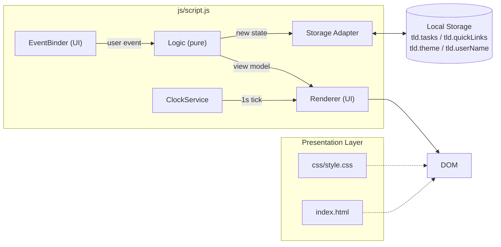
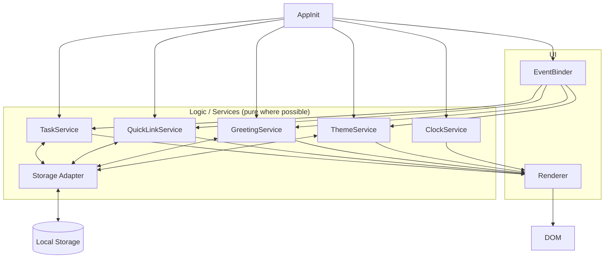
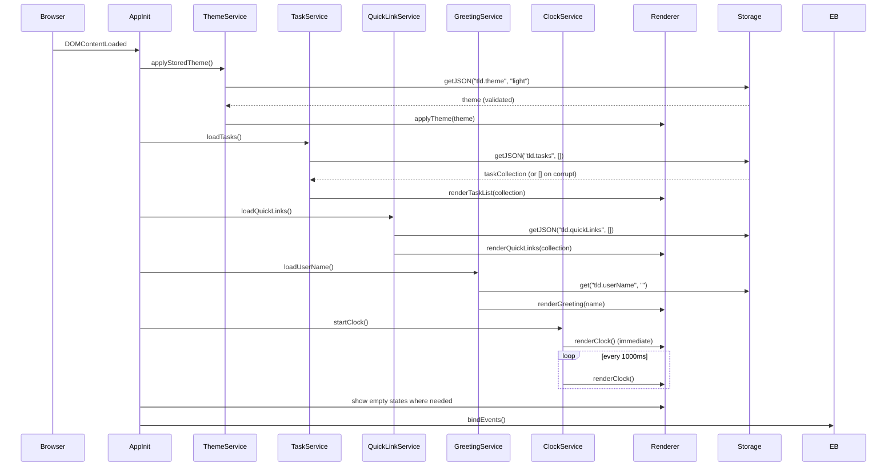

# Design Document

## Overview

The To-Do List Life Dashboard is a zero-dependency, single-page web application built entirely with HTML, CSS, and Vanilla JavaScript. It runs by opening `index.html` directly in a browser — no build step, package manager, server, or backend. All user data (Tasks, Quick Links, Theme, User_Name) is persisted in the browser's `window.localStorage` as JSON strings under dedicated storage keys, so state survives refreshes and restarts.

The dashboard consolidates five personal-productivity surfaces onto one minimal, aesthetic page:

- A personalized **Greeting** that incorporates a custom user name.
- A live **Date/Time** display that updates at least once per second.
- A **Task** manager with add / complete / delete and strict duplicate-name prevention.
- A **Quick Link** bookmark manager with add / edit / remove.
- A **Light/Dark Mode** toggle with a persisted preference.

Three challenges called out as core requirements drive key design decisions: the persisted theme toggle, the custom greeting name, and the case-insensitive, whitespace-trimmed duplicate-task rule.

### Confirmed Design Decisions

These decisions were confirmed during requirements clarification and are reflected throughout this design:

| Decision | Value | Rationale |
| --- | --- | --- |
| Duplicate matching | Trimmed + case-insensitive comparison | "Buy milk" == "  buy MILK  " — prevents ambiguity in the list |
| Default theme | Light Mode when none/invalid stored | Safe, predictable first-run experience |
| Quick Link URL normalization | Prepend `http://` when no protocol scheme present | Keeps links clickable without forcing the user to type a scheme |
| Clock update cadence | At least once per second | Seconds-precision display without visible stutter |
| Persistence format | JSON strings in Local Storage | Native, parseable, no external dependency |

### Scope

In scope: the dashboard application described above and its 15 requirements.

Out of scope: user accounts/authentication, server sync, cloud storage, due dates/priorities/tags on tasks, drag-and-drop reordering, reminders/notifications, i18n, and accessibility auditing beyond basic semantic HTML. These may be future work.

## Architecture

### High-Level Architecture

The application is a single-page browser app with three runtime concerns: **Presentation** (HTML structure + CSS styling), **Logic** (pure data-transformation functions in `js/script.js`), and **Persistence** (a thin adapter over `window.localStorage`). There is no framework, no virtual DOM, and no build pipeline. The DOM is updated imperatively by renderer functions that read state, recompute a view, and write it back to elements.

To keep the no-build constraint while still allowing the pure logic layer to be property-tested, `js/script.js` is organized into clearly separated namespaces:

- **`Logic`** — pure functions that take data and return data. No DOM access, no `localStorage` access. These are the testable core.
- **`Storage`** — a thin adapter that reads/writes JSON strings to `localStorage` with safe parsing and a fallback. Side-effectful, mocked or substituted in tests.
- **`UI`** — renderer functions that translate state into DOM, and event handlers that translate user input into state changes. Side-effectful.

All three live in the single `js/script.js` file (as required by the no-build / single-script constraint), but they are namespaced so the `Logic` layer can be exercised independently in a property-based test harness.

### File Structure

```
/
├── index.html          # Dashboard markup + structure
├── css/
│   └── style.css       # Theming via CSS custom properties + responsive layout
└── js/
    └── script.js       # Logic + Storage + UI namespaces, app bootstrap
```

Test artifacts (dev-time only, not loaded by the app) live under `tests/`:

```
tests/
├── test.html           # Browser-based test harness (loads fast-check via CDN + script.js)
└── properties.js       # Property-based and example-based tests
```

### Runtime Data Flow



User input flows: a DOM event is captured by `EventBinder`, which calls a pure `Logic` function to compute new state, persists it through `Storage`, then asks `Renderer` to repaint the affected region. The clock is an independent timer that re-renders the date/time element once per second.

### Component Diagram



### Load Sequence



### Add-Task with Duplicate-Check Sequence

```mermaid
sequenceDiagram
  participant U as User
  participant EB as EventBinder
  participant TS as TaskService
  participant L as Logic
  participant S as Storage
  participant RD as Renderer

  U->>EB: submit task name (form)
  EB->>L: trim(name)
  EB->>L: isDuplicateTask(tasks, name)
  alt is duplicate (case-insensitive, trimmed)
    L-->>EB: true
    EB->>RD: showDuplicateMessage(name)
    Note over EB,RD: Task list left unchanged; no storage write
  else valid (non-empty, unique)
    EB->>L: generateTaskId(tasks)
    EB->>TS: addTask(tasks, id, name)
    TS-->>EB: newCollection
    EB->>RD: renderTaskList(newCollection)
    EB->>S: set("tld.tasks", serialize(newCollection))
    RD-->>U: updated list
  end
```

## Components and Interfaces

This section defines each component, its responsibility, and its interface (function signatures). Signatures are written in TypeScript-like notation for clarity; the implementation is plain JavaScript. Functions marked **(pure)** have no DOM or `localStorage` dependency and are the primary targets for property-based testing.

### AppInit

Bootstraps the application on `DOMContentLoaded`: restores persisted state, renders initial views, starts the clock, and wires events.

- `init()` — orchestrates the load sequence above. Called once on startup.

### Storage Adapter

A thin, side-effectful wrapper over `window.localStorage` with safe JSON parsing. Every read returns a fallback on missing/corrupt data instead of throwing.

- `Storage.get(key: string): string | null`
- `Storage.set(key: string, value: string): void`
- `Storage.remove(key: string): void`
- `Storage.getJSON<T>(key: string, fallback: T): T` — parses JSON; on `null`, malformed JSON, or thrown error, returns `fallback`.
- `Storage.setJSON(key: string, value: unknown): void` — `JSON.stringify` then `set`.

### Logic (pure) — Task

- `normalizeTaskName(name: string): string` **(pure)** — returns `name.trim().toLowerCase()`. Used as the uniqueness key.
- `isValidTaskName(name: string): boolean` **(pure)** — `name.trim().length > 0`.
- `isDuplicateTask(tasks: Task[], name: string): boolean` **(pure)** — true if any existing task's `normalizeTaskName` equals `normalizeTaskName(name)`.
- `generateTaskId(tasks: Task[]): string` **(pure)** — produces an identifier unique within `tasks` (e.g., max numeric id + 1, or a timestamp + counter; uniqueness verified against the collection).
- `addTask(tasks: Task[], name: string): { ok: boolean, tasks: Task[], error?: string }` **(pure)** — validates, checks duplicates, appends `{ id, name: name.trim(), completed: false }`; returns `{ ok: false, error }` for empty/whitespace or duplicate.
- `toggleTaskComplete(tasks: Task[], id: string): Task[]` **(pure)** — returns a new collection with the matching task's `completed` flipped; others unchanged.
- `deleteTask(tasks: Task[], id: string): Task[]` **(pure)** — returns the collection minus the matching task.
- `serializeTasks(tasks: Task[]): string` **(pure)** — `JSON.stringify` in a stable shape.
- `deserializeTasks(json: string): Task[]` **(pure)** — parses and validates shape; returns `[]` on missing/corrupt without throwing.

### Logic (pure) — Quick Link

- `normalizeUrl(url: string): string` **(pure)** — if `url` (trimmed) has no protocol scheme (does not match `^[a-z][a-z0-9+.-]*://`), prepends `http://`; otherwise returns `url.trim()`.
- `isValidQuickLink(title: string, url: string): boolean` **(pure)** — both trimmed non-empty.
- `generateQuickLinkId(links: QuickLink[]): string` **(pure)** — unique within the collection.
- `addQuickLink(links: QuickLink[], title: string, url: string): { ok: boolean, links: QuickLink[], error?: string }` **(pure)** — validates, normalizes URL, appends `{ id, title: title.trim(), url: normalizedUrl }`.
- `editQuickLink(links: QuickLink[], id: string, title: string, url: string): { ok: boolean, links: QuickLink[], error?: string }` **(pure)** — updates in place on valid input; on empty title/url returns the original collection unchanged with an error.
- `removeQuickLink(links: QuickLink[], id: string): QuickLink[]` **(pure)** — minus the matching link.
- `serializeQuickLinks(links: QuickLink[]): string` **(pure)**
- `deserializeQuickLinks(json: string): QuickLink[]` **(pure)** — `[]` on corrupt.

### Logic (pure) — Greeting

- `normalizeUserName(name: string): string` **(pure)** — `name.trim()`.
- `buildGreeting(userName: string, date?: Date): string` **(pure)** — if `userName` is non-empty after trim, returns a time-of-day greeting including the name (e.g., `"Good morning, <name>."`); otherwise a default greeting that does not reference a name.

### Logic (pure) — Theme

- `isValidTheme(value: string): boolean` **(pure)** — `value === "light" || value === "dark"`.
- `normalizeTheme(value: string): "light" | "dark"` **(pure)** — returns `value` if valid, else `"light"` (the fallback).
- `toggleTheme(theme: "light" | "dark"): "light" | "dark"` **(pure)** — flips between the two.
- `serializeTheme(theme): string` **(pure)** — `JSON.stringify(theme)`.
- `deserializeTheme(json: string): "light" | "dark"` **(pure)** — parses; falls back to `"light"` on missing/corrupt/invalid.

### ClockService

Side-effectful timer that updates the date/time display.

- `startClock(): void` — renders immediately, then `setInterval(renderClock, 1000)`.
- `renderClock(): void` — writes current date/time to the clock element. Immediate first render satisfies requirement 11.3 before the first interval fires.

### Renderer (UI)

Translates state into DOM. Side-effectful.

- `renderTaskList(tasks: Task[]): void` — rebuilds the task list; shows the empty-state message when the list is empty.
- `renderQuickLinks(links: QuickLink[]): void` — rebuilds the quick link area; shows empty-state when empty.
- `renderGreeting(userName: string): void`
- `renderClock(): void`
- `applyTheme(theme: "light" | "dark"): void` — sets `document.documentElement.dataset.theme`.
- `showDuplicateMessage(name: string): void` — surfaces the duplicate-exists message.
- `clearDuplicateMessage(): void`
- `clearTaskInput(): void` — clears and refocuses the task input after a successful add.

### EventBinder (UI)

Wires DOM events to Logic + Storage + Renderer. Side-effectful.

- `bindEvents(): void` — attaches listeners for: task form submit, task list delegation (complete toggle, delete), quick link form submit, quick link edit/remove, user-name submit/clear, theme toggle.

### Design Decision: Namespacing for Testability

Because requirement 15 mandates the app loads JavaScript only from `js/script.js`, all logic must live in that one file. To keep it property-testable without a build step, `script.js` exposes the pure functions on a global namespace object (e.g., `window.TLD.Logic.*`). The browser-based test harness (`tests/test.html`) loads `script.js` and `fast-check` (from CDN) and exercises `window.TLD.Logic.*`. Production behavior is unaffected; the namespace is simply a grouping for tests. The `Storage` layer is substituted with a fake in-memory implementation in tests so the pure logic never touches real `localStorage`.

## Data Models

All state components are plain JSON-serializable values. Types are shown for clarity; the runtime is plain JavaScript.

### Task

```ts
interface Task {
  id: string;        // unique within the current task collection
  name: string;      // stored trimmed (leading/trailing whitespace removed)
  completed: boolean; // default false on creation
}
```

### Quick Link

```ts
interface QuickLink {
  id: string;    // unique within the current quick link collection
  title: string; // stored trimmed
  url: string;   // stored trimmed; guaranteed to have a protocol scheme (http:// prepended if missing)
}
```

### Theme

```ts
type Theme = "light" | "dark";
```

### User_Name

```ts
type UserName = string; // stored trimmed; empty string means "not set"
```

### Application State

The aggregate persisted state is the union of the four components below, each under its own storage key. They are stored independently so a corrupt value in one does not affect the others.

### Local Storage Key Strategy

| Storage Key | Value | Default when missing/corrupt | Serializer | Deserializer |
| --- | --- | --- | --- | --- |
| `tld.tasks` | JSON array of `Task` | `[]` | `serializeTasks` | `deserializeTasks` |
| `tld.quickLinks` | JSON array of `QuickLink` | `[]` | `serializeQuickLinks` | `deserializeQuickLinks` |
| `tld.theme` | JSON string `"light"` or `"dark"` | `"light"` | `serializeTheme` | `deserializeTheme` |
| `tld.userName` | JSON string (trimmed) | `""` | `JSON.stringify` | parse, fallback `""` |

All keys are namespaced with a `tld.` prefix to avoid collisions with other apps on the same origin.

### Naming Convention Note

The data model distinguishes between:
- **Task Name** — the human-readable label, stored trimmed. Uniqueness is decided on the trimmed, lowercased form (see `normalizeTaskName`), but the stored value preserves the original (trimmed) casing for display.
- **User_Name** — the greeting name, stored trimmed; empty means "not set" and triggers the default greeting.

## Correctness Properties

*A property is a characteristic or behavior that should hold true across all valid executions of a system-essentially, a formal statement about what the system should do. Properties serve as the bridge between human-readable specifications and machine-verifiable correctness guarantees.*

**PBT Applicability.** Property-based testing applies to the **pure `Logic` layer** of this dashboard — the data-transformation functions that take state and return state with no DOM or `localStorage` access (task/quick-link normalization, duplicate detection, add/edit/remove, serialization round-trips, corrupt-storage recovery, URL normalization, theme toggle/validation, user-name trimming, greeting construction). These functions have clear input/output behavior, behavior varies meaningfully with input, and 100+ iterations cheaply exercise whitespace, unicode, large collections, and edge cases.

PBT does **not** apply to UI rendering, the responsive layout, the clock's per-second cadence, and the no-build operation constraint. Those are covered by example-based unit tests, viewport integration tests, smoke tests, and manual visual verification (see Testing Strategy). This split follows the design's `Logic` / `UI` / `Storage` separation: pure logic is property-tested, side-effectful layers are example/integration-tested with a storage fake.

### Property 1: Valid task addition produces a well-formed, uniquely-identified task

*For any* task collection and any name whose trimmed form is non-empty and is not a duplicate of an existing task, `addTask` SHALL return `{ ok: true }` and append exactly one task whose `name` equals the trimmed input, whose `id` is unique within the resulting collection, and whose `completed` is `false`.

**Validates: Requirements 1.1, 1.2, 1.4**

### Property 2: Duplicate task submission is rejected and leaves the collection unchanged

*For any* task collection, any existing task name `N`, and any submitted name `S` such that `normalizeTaskName(S) === normalizeTaskName(N)` (trimmed, case-insensitive), `addTask` SHALL return `{ ok: false }` and the resulting collection SHALL equal the original collection unchanged.

**Validates: Requirements 2.1, 2.3, 2.4**

### Property 3: Empty or whitespace-only task name is rejected and leaves the collection unchanged

*For any* task collection and any name composed entirely of whitespace, `addTask` SHALL return `{ ok: false }` and the resulting collection SHALL equal the original collection unchanged.

**Validates: Requirements 1.3**

### Property 4: Completion toggle flips the target and preserves the rest

*For any* task collection, any task id present in the collection, and any number of applications `k`, `toggleTaskComplete` SHALL flip the `completed` status of the matching task and leave every other task unchanged; applying the toggle twice SHALL restore the original collection.

**Validates: Requirements 3.1**

### Property 5: Task deletion removes the target and preserves the rest

*For any* task collection and any task id present in the collection, `deleteTask` SHALL return a collection that excludes exactly the matching task and keeps every other task unchanged, decreasing the size by exactly one.

**Validates: Requirements 4.1**

### Property 6: Task collection persistence round-trip

*For any* valid task collection `C`, `deserializeTasks(serializeTasks(C))` SHALL deep-equal `C`, and `serializeTasks(deserializeTasks(serializeTasks(C)))` SHALL equal `serializeTasks(C)`.

**Validates: Requirements 5.5**

### Property 7: Corrupt task storage resets to empty without throwing

*For any* string that is not valid JSON encoding an array of well-formed tasks (including malformed JSON, `null`, non-array JSON, and arrays with missing/invalid fields), `deserializeTasks` SHALL return `[]` and SHALL NOT throw an exception.

**Validates: Requirements 5.4**

### Property 8: Valid quick link addition produces a well-formed link

*For any* quick link collection, any non-empty title, and any URL, `addQuickLink` SHALL return `{ ok: true }` and append exactly one link whose `title` equals the trimmed input, whose `id` is unique within the resulting collection, and whose `url` has a protocol scheme.

**Validates: Requirements 6.1**

### Property 9: URL scheme normalization prepends http:// only when a scheme is absent

*For any* URL string `U`, `normalizeUrl(U)` SHALL return a value that begins with a protocol scheme (`^[a-z][a-z0-9+.-]*://`); and *if* `U` (trimmed) already begins with a protocol scheme, `normalizeUrl(U)` SHALL equal `U.trim()`.

**Validates: Requirements 6.4**

### Property 10: Empty/whitespace quick link title or URL is rejected and leaves the collection unchanged

*For any* quick link collection and any submitted title or URL that is empty or composed entirely of whitespace, both `addQuickLink` and `editQuickLink` SHALL return `{ ok: false }` and the resulting collection SHALL equal the original collection unchanged (including preserving an existing link being edited).

**Validates: Requirements 6.2, 6.3, 7.2**

### Property 11: Quick link edit updates the target in place and preserves the rest

*For any* quick link collection, any link id present in the collection, any valid title, and any URL, `editQuickLink` SHALL return a collection of the same size in which the matching link's `title` equals the trimmed input and its `url` equals `normalizeUrl(input)`, while every other link is unchanged.

**Validates: Requirements 7.1**

### Property 12: Quick link removal removes the target and preserves the rest

*For any* quick link collection and any link id present in the collection, `removeQuickLink` SHALL return a collection that excludes exactly the matching link and keeps every other link unchanged, decreasing the size by exactly one.

**Validates: Requirements 8.1**

### Property 13: Quick link collection persistence round-trip

*For any* valid quick link collection `C`, `deserializeQuickLinks(serializeQuickLinks(C))` SHALL deep-equal `C`, and `serializeQuickLinks(deserializeQuickLinks(serializeQuickLinks(C)))` SHALL equal `serializeQuickLinks(C)`.

**Validates: Requirements 9.5**

### Property 14: Corrupt quick link storage resets to empty without throwing

*For any* string that is not valid JSON encoding an array of well-formed quick links (including malformed JSON, `null`, non-array JSON, and arrays with missing/invalid fields), `deserializeQuickLinks` SHALL return `[]` and SHALL NOT throw an exception.

**Validates: Requirements 9.4**

### Property 15: User name is trimmed before storing

*For any* string `S`, `normalizeUserName(S)` SHALL equal `S.trim()`.

**Validates: Requirements 10.5**

### Property 16: Greeting includes the name when set

*For any* non-empty name `N`, `buildGreeting(N)` SHALL contain the trimmed name; *for any* empty or all-whitespace name, `buildGreeting(N)` SHALL return the default greeting and SHALL NOT contain a user-supplied name.

**Validates: Requirements 10.1, 10.2**

### Property 17: Theme toggle flips and round-trips

*For any* theme `T` in `{ "light", "dark" }`, `toggleTheme(T)` SHALL return the other theme, and `toggleTheme(toggleTheme(T))` SHALL equal `T`.

**Validates: Requirements 12.1**

### Property 18: Theme persistence round-trip

*For any* valid theme `T` in `{ "light", "dark" }`, `deserializeTheme(serializeTheme(T))` SHALL equal `T`.

**Validates: Requirements 13.4**

### Property 19: Invalid or corrupt theme falls back to light without throwing

*For any* string that does not deserialize to `"light"` or `"dark"` (including malformed JSON, `null`, and valid JSON with an invalid value), `deserializeTheme` SHALL return `"light"` and SHALL NOT throw an exception.

**Validates: Requirements 13.3**

**Coverage of Non-Property Acceptance Criteria.** The following acceptance criteria are intentionally not expressed as properties because they concern UI rendering, side effects, timing, layout, or structural constraints. They are covered by example-based unit tests, integration tests with a storage fake, smoke tests, and manual visual verification, as detailed in the Testing Strategy:

| Requirement | Reason not a property | Test type |
| --- | --- | --- |
| 2.2 (duplicate message) | UI message rendering | Example |
| 3.2 (visual distinguish complete) | CSS visual styling | Example / visual |
| 3.3, 4.2, 7.3, 8.2 (persist on change) | Side effect to localStorage | Integration |
| 4.3, 8.3 (empty-state on last delete) | Specific boundary + UI | Example / edge |
| 5.1, 5.2, 9.1, 9.2 (serialize/deserialize wiring) | Storage integration | Integration |
| 5.3, 9.3, 13.2 (init empty/default) | Missing-key scenario | Example |
| 10.3, 10.4 (name submit/clear + persist) | UI + side effect | Example + Integration |
| 11.1 (display current time) | UI rendering | Example / smoke |
| 11.2 (update >= once/sec) | Timing cadence | Smoke |
| 11.3 (immediate first render) | Specific scenario | Smoke / example |
| 12.2, 12.3 (apply palette) | CSS application | Example |
| 12.4, 13.1 (persist/apply theme) | Side effect / integration | Integration |
| 14.1–14.4 (responsive layout) | CSS layout at viewports | Integration / visual smoke |
| 15.1, 15.2, 15.3 (no-build operation) | Structural/deployment | Smoke |

## Error Handling

The dashboard degrades gracefully on every malformed input and corrupt persisted value. None of these paths should crash the app or throw to the global handler.

### Corrupt or Unreadable Storage

Every storage read goes through `Storage.getJSON(key, fallback)`, which wraps `JSON.parse` in `try/catch`. On `null` (missing key), a thrown `SyntaxError` (malformed JSON), or a value that fails shape validation, the caller receives the fallback:

- `tld.tasks` corrupt → task list initialized to `[]` (Req 5.4).
- `tld.quickLinks` corrupt → quick link collection initialized to `[]` (Req 9.4).
- `tld.theme` corrupt or invalid → `"light"` applied (Req 13.3).
- `tld.userName` corrupt → `""` (default greeting).

Each storage key is independent, so corruption of one component never affects the others.

### Invalid User Input

Input validation happens in the pure `Logic` layer before any state mutation or storage write, so invalid input never partially mutates state:

- Empty/whitespace task name → rejected, list unchanged, no storage write (Req 1.3).
- Duplicate task name → rejected with a visible message, list unchanged, no storage write (Req 2.1–2.3).
- Empty/whitespace quick link title or URL → rejected on add and edit, collection unchanged (Req 6.2, 6.3, 7.2).

Rejected inputs surface a user-facing message (duplicate, empty title/url) and do not clear the input field, so the user can correct and resubmit.

### Identifier Uniqueness

`generateTaskId` / `generateQuickLinkId` verify uniqueness against the current collection before use, so concurrent rapid additions cannot produce collisions even if a timestamp-only scheme were reused within the same millisecond.

### Defensive Rendering

- An empty task list or quick link area renders a dedicated empty-state element rather than a blank region (Req 4.3, 8.3).
- Renderers rebuild the affected region from the authoritative in-memory collection, so the DOM is always consistent with state; a failed render does not leave stale elements.
- The clock's `setInterval` is the only recurring timer; if the clock element is missing, `renderClock` no-ops rather than throwing.

### No Global Dependencies

Because the app is no-build and loaded via `file://`, it never depends on network resources at runtime. A dropped network connection (relevant only to tests that load `fast-check` from a CDN) does not affect the running dashboard.

## Testing Strategy

A dual testing approach combines property-based tests for the pure logic layer with example-based, integration, and smoke tests for the side-effectful and presentation layers.

### Property-Based Testing (Logic layer)

- **Library**: [`fast-check`](https://fast-check.dev/) — the standard JavaScript/TypeScript property-based testing framework (QuickCheck-style).
- **Harness**: a browser-based, no-build test page at `tests/test.html` that loads `js/script.js` and `fast-check` from a CDN, then runs `tests/properties.js`. Loading `script.js` exposes `window.TLD.Logic.*`; the harness substitutes a fake in-memory storage so pure functions are tested in isolation from real `localStorage`. (Alternatively, a Node + `vitest` + `fast-check` + `jsdom` setup may be used for CI; either way the *app* remains no-build — only the dev-time test harness differs.)
- **Generators**: custom `fast-check` arbitraries for `Task`, `QuickLink`, task/quick-link collections, names with leading/trailing whitespace, all-whitespace strings, URLs with and without schemes, malformed JSON strings, and invalid theme values.
- **Iterations**: each property test runs a **minimum of 100 iterations** (fast-check default `numRuns: 100`).
- **Tagging**: every property test is tagged with a comment referencing its design property, in the format:
  `// Feature: todo-life-dashboard, Property 6: Task collection persistence round-trip`
- **Mapping**: each of the 19 properties above maps to exactly one property-based test exercising the corresponding `Logic` function(s).

### Example-Based Unit Tests (UI + edge cases)

Specific scenarios and edge cases not suited to PBT, run in the same harness (or `jsdom`):

- Submit a duplicate task → duplicate message is visible (Req 2.2).
- Toggle a task complete → the completed class/attribute is present on that element (Req 3.2).
- Delete the last task → empty-state message shown (Req 4.3).
- Remove the last quick link → empty-state shown (Req 8.3).
- Missing storage key on load → tasks/quick links/theme/userName initialize to defaults (Req 5.3, 9.3, 13.2).
- Set/clear user name → greeting updates immediately and default greeting on clear (Req 10.3, 10.4).
- Apply dark/light theme → `data-theme` attribute set accordingly (Req 12.2, 12.3).

### Integration Tests (side effects)

Using an in-memory storage fake to verify wiring without touching real `localStorage`:

- Completing/deleting a task persists the updated collection under `tld.tasks` (Req 3.3, 4.2, 5.1).
- Editing/removing a quick link persists under `tld.quickLinks` (Req 7.3, 8.2, 9.1).
- Theme change persists under `tld.theme` (Req 12.4); theme applied on load (Req 13.1).
- Load restores seeded tasks/quick links/theme (Req 5.2, 9.2).

### Smoke Tests (setup, timing, structure)

- Clock renders immediately on load and registers a 1000ms interval (fake timers) (Req 11.1, 11.2, 11.3).
- `index.html` loads via `file://` in a headless browser and renders without errors (Req 15.1).
- `index.html` references only `./css/style.css` and `./js/script.js`; no external `<link>`/`<script src>` (Req 15.2).
- `script.js` contains no framework imports and no `fetch`/`XMLHttpRequest`/backend calls (Req 15.3).

### Responsive Layout Verification

The responsive breakpoints are CSS-driven and verified through viewport integration tests plus manual visual checks:

- Desktop ≥1024px → multi-column layout (Req 14.1).
- Tablet 768–1023px → tablet layout (Req 14.2).
- Mobile <768px → single-column layout (Req 14.3).
- All breakpoints → controls remain visible and usable (Req 14.4, manual).

### Test Balance

Property tests cover the broad input space of the pure logic (whitespace, unicode, large collections, corrupt JSON, schemeless URLs). Example and integration tests pin down concrete UI behaviors, storage wiring, timing, and the no-build structural constraints. This keeps the suite fast (pure functions in memory) while still validating the side-effectful presentation layer with a small number of representative examples.
